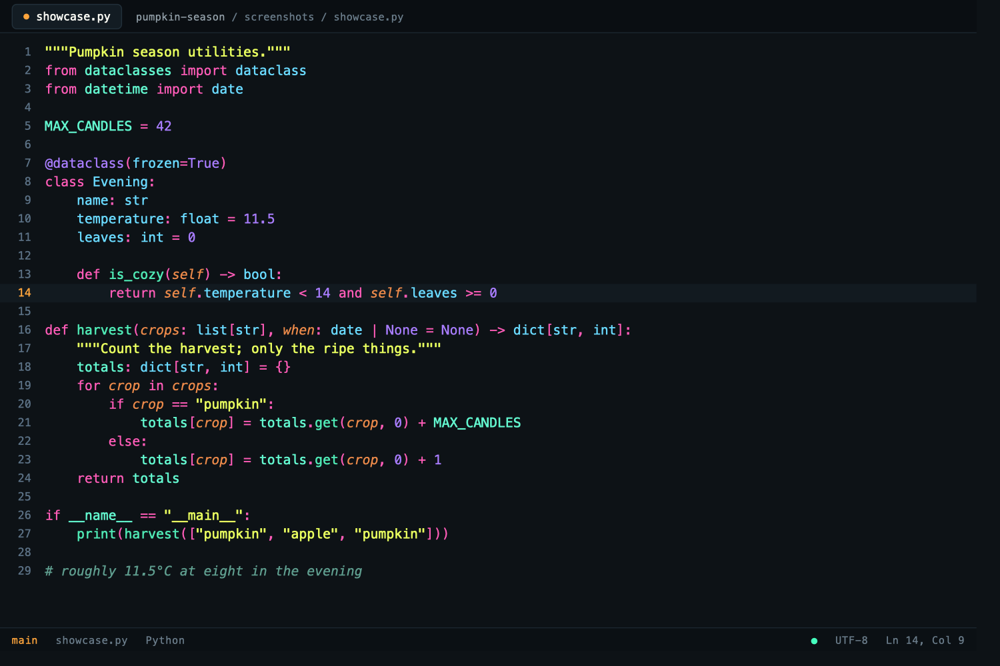

# Pumpkin Season

A dark theme for [Zed](https://zed.dev).

I really do enjoy fancy syntax highlighting, soft colour palettes and chill
backgrounds, so I tried to transfer that feeling here — though I'm not a
designer. Anyway, I hope you enjoy it.



## Install

Copy the theme into Zed's config folder:

```sh
mkdir -p ~/.config/zed/themes
cp themes/pumpkin-season.json ~/.config/zed/themes/
```

Open the theme selector with `cmd-k cmd-t` and choose **Pumpkin Season**.

Or run the script, which does the same thing:

```sh
./install.sh
```

## Palette

| Role | Colour |
| --- | --- |
| Background | `#0d1216` |
| Panels | `#11181d` |
| Elements | `#172027` |
| Borders | `#22303a` |
| Editor text | `#f8f8f2` |
| UI text | `#ff8c42` |

Accents: amber `#ffd23f`, ember `#ff8c42`, rose `#ff5cb8`, cyan `#6adaff`,
mint `#45ffbe`, lime `#e9ff5f`, violet `#a97dff`, teal `#63f7cf`.

Syntax: keywords and operators in pink, strings in lime, numbers and constants
in violet, functions in mint, types in cyan, parameters in italic orange, and
comments in muted green.

## Notes

- **Dark mode only.** A Zed theme declares an appearance — `dark` or `light` —
  and this one is dark, so it won't be offered while your system is in light
  mode. Zed will use a light theme instead.
- Also the theme of [my blog](https://pumpkinseason.github.io/my-blog/).
- No fonts are bundled. It is designed around a monospaced buffer font; this
  is what it looks like with SF Mono:

```json
{
  "buffer_font_family": "SF Mono",
  "buffer_font_size": 16,
  "buffer_font_weight": 400,
  "buffer_font_features": { "calt": 1, "liga": 1 }
}
```

## Files

- `themes/pumpkin-season.json` — the theme
- `install.sh` — copies it into `~/.config/zed/themes`
- `screenshots/` — the preview, and `showcase.py` used to take it

## License

MIT — © 2026 [PumpkinSeason](https://github.com/PumpkinSeason)
